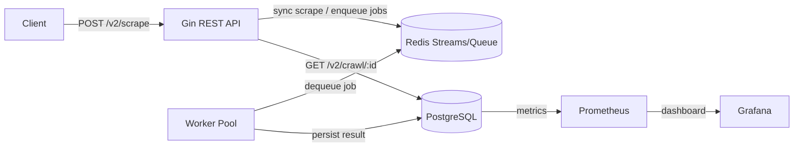

# Web Gobbler

[](https://goreportcard.com/report/github.com/Masralai/web-gobbler)
[](https://opensource.org/licenses/MIT)
[](https://golang.org/dl/)

Distributed web scraping service built with Go (Gin), Redis, PostgreSQL, and Docker. Public scraping API is exposed as a v2-compatible subset under `/v2`.

> [!TIP]
> **Get started in 2 commands:**
>
> ```bash
> docker compose up -d
> curl -s http://localhost:8080/v2/scrape -H 'Content-Type: application/json' -d '{"url":"https://example.com","formats":["markdown"]}'
> ```
>
> Health: `GET /health`, `GET /ready`, `GET /api/v1/health` (non-scraping). API contract/spec: [spec/spec-architecture-v2-port.md](spec/spec-architecture-v2-port.md). OpenAPI: [openapi-v2.json](openapi-v2.json). For a local AWS-shaped sandbox ($0): **`./scripts/floci-up.sh`** — see [Floci sandbox](#floci-sandbox-local-aws-0).

## Architecture



## Features

- v2 routes: scrape, crawl, map, batch scrape, search (SearXNG), extract (LLM), parse, concurrency check
- Configurable scrape formats: `markdown`, `html`, `rawHtml`, `links` (plus JSON/screenshot formats per spec/provider availability)
- Async jobs for crawl/batch/extract with status/cancel/errors routes
- Per-domain rate limiting, retries/backoff in worker paths
- SSRF protections and strict request validation
- Health checks: `/health`, `/ready`, `/api/v1/health`
- Prometheus metrics, Grafana dashboard
- Distroless Docker images, Terraform for AWS/OCI deployment profiles

## Local development

### Prerequisites

- Go 1.26+
- Docker and Docker Compose

### Start services

```bash
docker compose up -d
```

This starts API (port 8080), worker, PostgreSQL, Redis, Prometheus, Grafana (per compose config).

### Verify

```bash
curl http://localhost:8080/health
curl http://localhost:8080/api/v1/health
curl -s http://localhost:8080/v2/scrape \
  -H 'Content-Type: application/json' \
  -d '{"url":"https://example.com","formats":["markdown"]}'
```

Migrations run automatically on API/worker startup (`store.Migrate`) when enabled.

See [spec/spec-architecture-v2-port.md](spec/spec-architecture-v2-port.md) for request/response contracts and implementation status. For local AWS sandbox: [docs/FLOCI_SANDBOX.md](docs/FLOCI_SANDBOX.md).

## Floci sandbox (local AWS, $0)

Practice the real AWS resource graph (VPC → RDS → ElastiCache → ECR → ECS) against a local [Floci](https://floci.io) endpoint — **no AWS account and no cloud spend**. Local-only.

Normal `docker compose up -d` is unchanged. The sandbox uses the `sandbox` compose profile and `deploy_mode=floci`.

### Run

```bash
./scripts/floci-up.sh
# optional end-to-end scrape smoke test (/v2/scrape):
./scripts/floci-up.sh --smoke-test
```

The script starts Floci, applies Terraform (`deploy_mode=floci`), builds/pushes api+worker images, migrates Postgres, and polls `GET http://localhost:8080/api/v1/health` (health route retained). Teardown: `docker compose --profile sandbox down -v`.

See **[docs/PRD_FLOCI_SANDBOX.md](docs/PRD_FLOCI_SANDBOX.md)** and **[docs/FLOCI_SANDBOX.md](docs/FLOCI_SANDBOX.md)**.

## API (v2)

Base URL: server root (no `/api` prefix). Auth: `Authorization: Bearer <API_KEY>` when `API_KEY` is set. Full contract and intentional deviations: [spec/spec-architecture-v2-port.md](spec/spec-architecture-v2-port.md). OpenAPI: [openapi-v2.json](openapi-v2.json).

### Common routes

- `POST /v2/scrape` — synchronous scrape (`url`, `formats` like `["markdown","links"]`, `timeout`, etc.) → `{success,data,scrape_id}`
- `GET /v2/scrape/:jobId` — scrape status/document
- `POST /v2/crawl` → `{success,id,url}`; `GET /v2/crawl/:jobId` (status, pagination), `DELETE /v2/crawl/:jobId`, `GET /v2/crawl/:jobId/errors`, `GET /v2/crawl/ongoing|active`
- `POST /v2/map` → `{success,id,links}`
- `POST /v2/batch/scrape` and `GET|DELETE /v2/batch/scrape/:jobId`, `GET /v2/batch/scrape/:jobId/errors`
- `POST|GET /v2/search` (requires `SEARXNG_ENDPOINT`)
- `POST /v2/extract`, `GET /v2/extract/:jobId` (requires LLM config; disabled in demo mode)
- `GET /v2/parse/formats`, `POST /v2/parse` (multipart `file`)
- `GET /v2/concurrency-check`
- `POST|DELETE /v2/scrape/:jobId/interact` → 501 (not implemented)
- Health (non-v2 envelope): `GET /health`, `GET /ready`, `GET /api/v1/health`

### Example: scrape

```bash
curl -s http://localhost:8080/v2/scrape \
  -H 'Content-Type: application/json' \
  -d '{"url":"https://example.com","formats":["markdown","links"]}'
```

### Example: crawl

```bash
curl -s http://localhost:8080/v2/crawl \
  -H 'Content-Type: application/json' \
  -d '{"url":"https://example.com","limit":2}'
# poll: GET /v2/crawl/<id>
```

Legacy `/api/v1` scraping routes (`/scrape`, `/crawl`, `/map`, `/jobs*`) are not registered by default; use `/v2`. See the spec for status codes, envelopes, and unsupported fields.

## Running tests

```bash
# Unit tests (33 tests across scraper + API handlers)
go test -race -cover ./...

# Integration tests (requires Docker for PostgreSQL + Redis containers)
docker compose up -d postgres redis
go test -tags=integration -race -v ./test/integration/...
docker compose down

# Load tests (requires k6: brew install k6)
k6 run test/load/scenario.js

# Vulnerability check
go run golang.org/x/vuln/cmd/govulncheck@latest ./...
```

> [!NOTE]
> Integration tests use testcontainers-go and spin up real PostgreSQL + Redis containers. Ensure Docker is running and the `integration` build tag is set.

## Production deployment

### Prerequisites

- AWS account with permissions for ECS, ECR, RDS, ElastiCache, IAM
- Terraform installed
- Docker installed

### Infrastructure

```bash
# Initialize Terraform
cd terraform
terraform init

# Review and apply
terraform plan
terraform apply
```

This provisions VPC, RDS PostgreSQL, ElastiCache Redis, ECR repositories, ECS Fargate cluster with API and worker services, ALB, and auto-scaling.

> [!WARNING]
> Terraform creates real AWS resources. Review the plan carefully before applying. Estimated monthly cost: ~$60–100 for the full stack.

### CI

GitHub Actions runs **CI only** (`.github/workflows/ci.yml`) on pushes and pull requests to `main`:

1. `go vet`
2. Advisory `govulncheck` (non-blocking)
3. `go build` for api + worker
4. Unit tests (`go test -race -cover ./...`)
5. Integration tests (Compose Postgres + Redis)

There is **no automatic ECS deploy** from Actions today (no live default AWS stack). Practice the Terraform graph locally with Floci (`./scripts/floci-up.sh`). Real AWS: [docs/how-to/deploy-aws.md](docs/how-to/deploy-aws.md) (Terraform + manual image push; optional future OIDC CD).

## Environment variables

### Server

| Variable | Default | Required | Description |
|----------|---------|----------|-------------|
| `PORT` | `8080` | No | API server port |
| `LOG_LEVEL` | `INFO` | No | Log level (DEBUG, INFO, WARN, ERROR) |

### Database & Queue

| Variable | Default | Required | Description |
|----------|---------|----------|-------------|
| `DATABASE_URL` | — | **Yes** | PostgreSQL connection string |
| `REDIS_URL` | — | **Yes** | Redis connection string |

> [!WARNING]
> `DATABASE_URL` and `REDIS_URL` have no defaults. The server will exit immediately if either is unset. Never hardcode credentials.

### Scraper

| Variable | Default | Required | Description |
|----------|---------|----------|-------------|
| `DEFAULT_TIMEOUT_SEC` | `10` | No | HTTP timeout for scrapers |
| `DEFAULT_MAX_RETRIES` | `3` | No | Max retry attempts per job |
| `SCRAPER_RATE_LIMIT` | `2` | No | Per-domain requests per second |
| `WORKER_CONCURRENCY` | `5` | No | Goroutines per worker |

### Observability

| Variable | Default | Required | Description |
|----------|---------|----------|-------------|
| `GOSCRAPE_ENVIRONMENT` | `prod` | No | Environment label for CloudWatch metrics |

## Project structure

```dir
├── cmd/
│   ├── api/             main.go — Gin server entrypoint
│   └── worker/          main.go — Worker pool entrypoint
├── internal/
│   ├── api/             Handlers, middleware, types, validation
│   ├── scraper/         Core extraction logic (goquery)
│   ├── queue/           Redis enqueue/dequeue helpers
│   ├── store/           PostgreSQL CRUD (pgx)
│   └── metrics/         Prometheus metric registration
├── migrations/          SQL migration files
├── docker/              Dockerfiles, Prometheus config, Grafana dashboard
├── docs/                Specs, how-tos, Floci sandbox PRD
├── scripts/             Bootstrap helpers (e.g. floci-up.sh)
├── terraform/           AWS / Floci infrastructure as code
├── test/
│   ├── integration/     Testcontainers integration tests
│   └── load/            k6 load test scripts
├── .github/workflows/   CI (test/build)
├── docker-compose.yml   Local development (+ sandbox profile)
└── README.md
```
